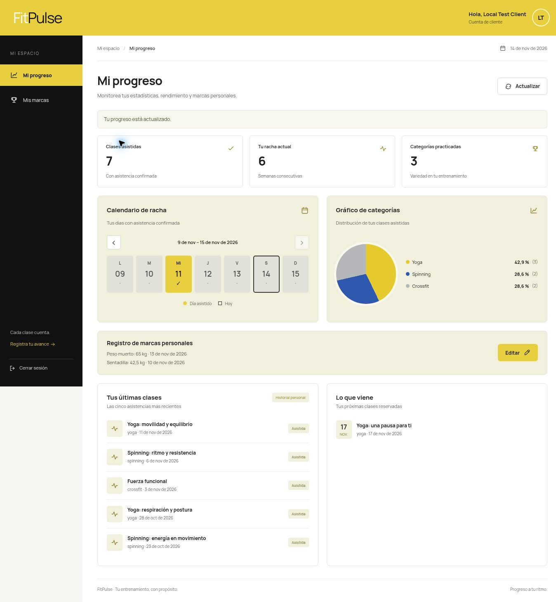
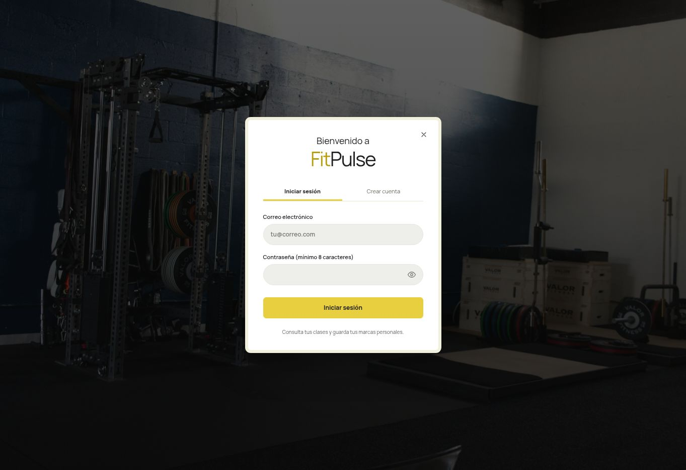

# Progreso y marcas personales

Se agregan **dos páginas HTML**, servidas por la propia API:

| Página | Dirección local con la configuración de ejemplo |
| --- | --- |
| Mi progreso | `http://localhost:5000/progress.html` |
| Mis marcas personales | `http://localhost:5000/personal-records.html` |

La raíz `/` redirige a progreso. Los archivos están en `public/`; JavaScript y CSS compartidos evitan repetir la lógica de acceso y los estilos. No necesitan Live Server ni un framework adicional. Se abren después de `npm start`, mediante HTTP.

## Diseño y referencia

La usuaria aportó capturas de **Mi progreso**, su estado de carga y los formularios de **login/registro** del prototipo. La interfaz se ajustó a esas referencias: amarillo, negro y blanco; paneles crema; calendario de racha de lunes a domingo; gráfico circular con leyenda y resumen de marcas con botón **Editar**. Se mantuvo una mejora moderada de espaciado, tamaños de lectura y contraste. La navegación incluye las dos secciones funcionales de Laura.

El acceso conserva la tarjeta blanca con borde crema, fondo de gimnasio, campos redondeados y botones amarillos. Incluye alternancia login/registro, confirmación de contraseña y un control para mostrarla. La confirmación se comprueba en el navegador y no se envía como campo adicional al endpoint. La fotografía es una alternativa con licencia documentada en `public/assets/README.md`; no es el mismo recurso del prototipo.

La comparación se hizo contra las capturas proporcionadas. La integración no permitió abrir el archivo editable de Figma `JeV0ijBsh49UI6l3EPrBoD`, nodo `0:1`, por lo que no se declara una reproducción exacta de sus medidas o componentes. Manrope se sirve localmente con su licencia OFL. Hay foco visible, etiquetas, mensajes `aria-live`, descripciones textuales de gráficos y reducción de movimiento. La revisión se realizó en escritorio; queda pendiente la prueba en una tablet física.

## Datos y operaciones reales

| Vista o acción | Endpoint utilizado |
| --- | --- |
| Registro desde el diálogo de acceso | `POST /users` |
| Inicio de sesión | `POST /sessions` |
| Comprobación del perfil | `GET /users/{id}` |
| Racha, clases asistidas y categorías | `GET /users/{userId}/progress` |
| Historial y próximas clases | `GET /users/{userId}/reservations`, con filtro de estado |
| Lista de marcas | `GET /users/{userId}/personal-records` |
| Nueva marca | `POST /users/{userId}/personal-records` |
| Editar marca | `PATCH /personal-records/{id}` |
| Eliminar marca | `DELETE /personal-records/{id}` |

Las listas se consultan por páginas hasta completar los resultados; no se presupone que los primeros 100 sean todos. No se incorporaron resultados, marcas o asistencias ficticias en el HTML ni en los módulos del navegador. Los registros sintéticos de la revisión se cargaron exclusivamente en una base de pruebas.

La racha y los totales vienen del servidor. El calendario usa las fechas de asistencias confirmadas en la zona horaria configurada y permite consultar semanas anteriores sin alterar la racha. El gráfico circular calcula porcentajes sobre el total de asistencias, con sus cantidades en la leyenda; el resumen muestra las dos marcas más recientes. El gráfico de marcas reúne solo el mismo ejercicio, tipo y unidad. No compara kg con lb ni distancia con tiempo. La lista de clases conserva la asistencia confirmada por el administrador; la interfaz del cliente no puede confirmarla por sí misma.

## Usar las páginas

1. Configura `.env` y ejecuta `db:setup`, la migración si tienes cuentas existentes, `db:seed` y `db:demo`.
2. Inicia la API con `npm start` y abre una de las direcciones anteriores.
3. Pulsa **Iniciar sesión**. Usa el correo y contraseña de `DEMO_CLIENT_EMAIL` y `DEMO_CLIENT_PASSWORD`, o crea una cuenta desde la pestaña **Crear cuenta**.
4. En marcas, pulsa **Nueva marca** y completa ejercicio, tipo, resultado, unidad y fecha. Puedes buscar, filtrar, ordenar, editar y eliminar con confirmación.
5. En progreso, consulta tus asistencias, navega entre semanas del calendario y pulsa **Actualizar** después de que el administrador confirme una asistencia.

Una cuenta nueva puede mostrar cero asistencias y ninguna marca: es el estado vacío correcto. `db:demo` prepara una reserva terminada, pero no confirma su asistencia. Para mostrar esa clase como asistida, entra como administrador en Swagger, busca la reserva del cliente y ejecuta `PATCH /reservations/{id}/attendance` con `{"status":"attended"}`. Después actualiza la página del cliente. Las dos interfaces conservan sus tokens por separado: autorizar Swagger no inicia sesión automáticamente en el HTML.

## Estados de interacción

- Carga: aviso visible y botón de envío desactivado mientras se espera al servidor.
- Error: se muestra el rechazo de la API y se conserva el formulario para corregirlo; los fallos de carga permiten reintentar.
- Confirmación: una operación correcta actualiza la lista desde la API y muestra el resultado.
- Vacío: hay un mensaje propio si no existen asistencias, reservas, marcas o resultados de búsqueda.
- Sesión terminada: se retiran los datos y se ofrece iniciar sesión nuevamente.

El administrador puede consultar su información, pero los botones de escritura de marcas requieren una cuenta de cliente. El servidor sigue comprobando propiedad y rol en cada operación: ocultar un botón no sustituye esa comprobación.

## Integración con el equipo

Este cambio cubre las dos páginas de Laura y un diálogo de registro/login para utilizarlas. No implementa el catálogo, compras, reservas ni el panel completo como pantallas web. Sus endpoints continúan disponibles. El informe consolidado y el video funcional se integran con el resto de la entrega del equipo. Los bloques del segundo corte en `docs/informe/` se conservan como documento histórico; los fragmentos de esta evolución están en esta carpeta.

La [guía desde cero](../guia-desde-cero.md) detalla la preparación de Windows, las dos rutas de base de datos, las pruebas de hash/salt y la comprobación manual del HTML.

## Capturas de la revisión

Vistas de escritorio tomadas del navegador, con datos sintéticos de la base de pruebas. No representan el contenido de la base del usuario.

